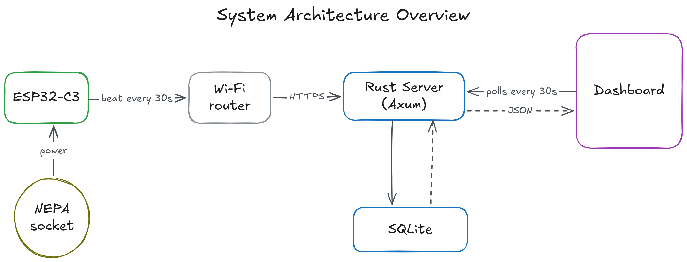
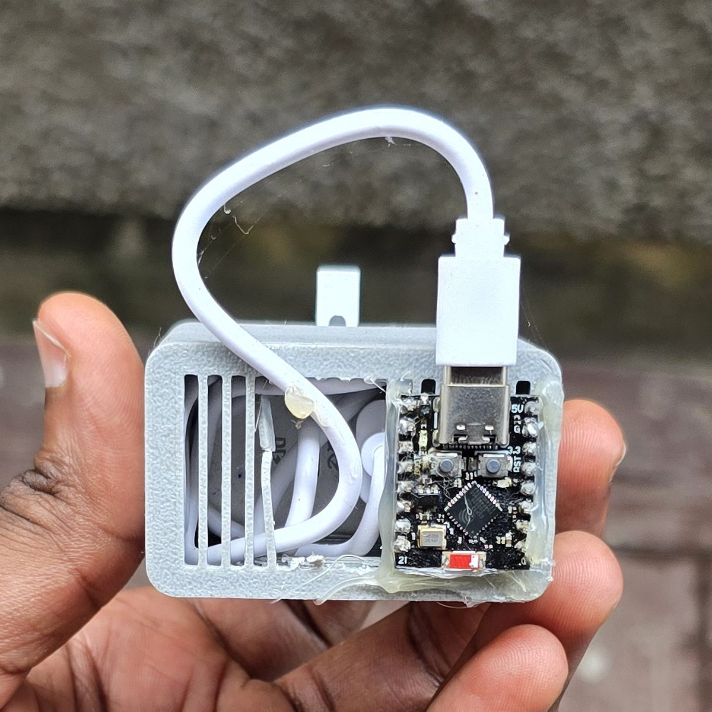
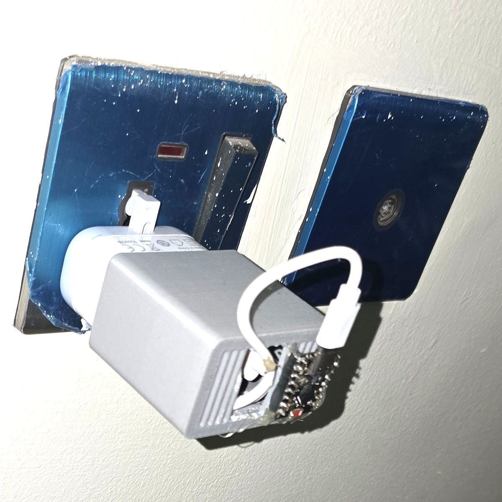
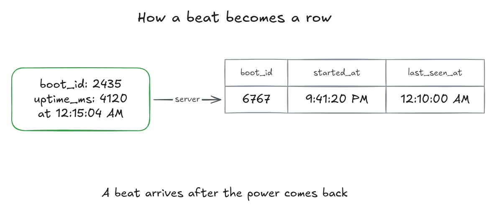

+++
title = "Building a Home Electricity Monitor"
date = 2026-10-29
+++
Imagine you’re at work, and you are deciding on whether to charge your devices before you leave office or to charge them when you get home, but then you wonder, "omo shey light dey house?".
Well, I often find myself in situations where I want to know if I currently have light, when they took the light, or how long I've had light. So, I built a system that tells me exactly that.

## The Idea

To solve this issue, I thought of building a simple device that communicates with my web server to notify me when I have power or not. The device works by sending a ***beat*** —an HTTP request every 30 seconds to my server. The device is plugged into a socket that only gets power from NEPA (the grid), not from the inverter. 

With this socket setup, I only receive beat requests whenever there is direct power supply from NEPA since the device is off otherwise. So all I have to do to determine if I have power at home is to check on the server side, when I last received a beat from the device. If the database says that the last beat was received more than 90 seconds ago, I can assume that there is no power at home.  

## System Architecture

An ESP32-C3 dev module is programmed to send a request every 30 seconds to a small VPS running a Rust (Axum) backend service and an SQLite database. 

When the server receives a request, it records it in the SQLite database. A simple dashboard built, with no extra libraries like React, displays analytics that answer my opening questions: whether power is ON/OFF, how long it has been ON/OFF, and how many hours of power there's been today and this week. The dashboard polls the server every 30 seconds and the server queries the SQLite database to get the relevant data.




## The ESP32 Device

### How does the ESP32 device work?

The ESP32-C3 is powered by a USB cable which is connected to a socket that only works when NEPA is available. 

When NEPA is available, the ESP32 turns on and begins sending ***beat*** requests to the server every 30 seconds. 

The ESP32 is attached to a 3D printed sleeve that slides over a USB-C phone charger. I used a spare phone charger I had lying around. 






### What is a beat request made of?

Each beat is a small JSON `POST` to `/beat`. Here is a sample request below: 

```http
POST /beat HTTP/1.1
Content-Type: application/json
Authorization: Bearer <API_KEY>

{"device_id": "homev1", "boot_id": 2435, "reset_reason": "power_on", "uptime_ms": 4120}
```

A beat request is made of 4 fields:

1. **device_id**: This lets the server tell devices apart, so one server could be used to monitor multiple devices. 
2. **boot_id**: This is randomly generated every time the ESP32 powers on. It lets the server detect a reboot of the ESP32, which usually means they took the light and brought it back.
3. **reset_reason**: This contains the reason why the ESP32 rebooted. The ESP32 could reboot either due to power outage, or due to random system crashes. A reset_reason of power_on or brownout is most likely because of a power outage, while a reset_reason of watchdog or panic means the ESP32 board crashed and there might not have been a power outage. See [Espressif's full list of reset reasons](https://docs.espressif.com/projects/esp-idf/en/stable/esp32c3/api-reference/system/misc_system_api.html#_CPPv418esp_reset_reason_t).
4. **uptime_ms**: When the ESP32 boots up, it spends some time setting up the Wi-Fi connection before the first beat request is sent. This tracks how long the ESP32 has been on. The server subtracts uptime_ms from the current time to find the actual time when the power came back. 

A beat request also contains an "Authorization" header carrying an API key, so only my device can send beats.

The `boot_id` and `reset_reason` are set once when the board boots: 
```cpp
const char* getReasonForReset() {
	esp_reset_reason_t reason = esp_reset_reason();
	
	switch (reason) {
		// ...
		case esp_reset_reason_t::ESP_RST_PANIC:
			return "panic";
		case esp_reset_reason_t::ESP_RST_INT_WDT:
		case esp_reset_reason_t::ESP_RST_TASK_WDT:
		case esp_reset_reason_t::ESP_RST_WDT:
			return "watchdog";
		default:
			return "unknown";
	}
}
void setup() {
	// ...
	// Connect to Wi-Fi network
	setupWifi();
	
	boot_id = esp_random();
	reset_reason = getReasonForReset();
}
```    

## The Web Server

The backend code that handles all requests and communicates with the SQLite database is written in Rust. SQLx and Axum were the main libraries used for database communication and request handling respectively. 

### How is a beat request stored in the database?
The server doesn't store beats. It stores power periods. A power period represents a continuous stretch of power, i.e., a period (duration) in which there is light. 

```sql
CREATE TABLE power_periods (
  id INTEGER PRIMARY KEY AUTOINCREMENT,
  device_id TEXT NOT NULL,
  boot_id INTEGER NOT NULL,
  reset_reason TEXT NULL,
  started_at TEXT NOT NULL,
  last_seen_at TEXT NOT NULL
);
```

The `started_at` column represents when the power came on, i.e., the time they brought light, and `last_seen_at` is the time the latest beat for that period was received.

When a beat request arrives, the Rust backend code first checks if the `boot_id` of that beat is the same as the `boot_id` in the last updated power period for that `device_id`.
- If the boot_ids are the same, then we update the `last_seen_at` column of the last updated power period to the current time. 
- If the boot_ids are different or there are no power periods yet, we insert a new power period row into the database. The `started_at` column of the new row is the current time minus `uptime_ms`. A change in the `boot_id` usually means that there was an outage.

This method of using each beat to update or insert a new power period instead of storing each beat is advantageous because it dramatically reduces the growth rate of the database.



### How does it know there is no light?
Say the server receives a beat from the ESP32 device at 12:10 AM, and then receives no new beat from that device within a 90-second window. We can assume the ESP32 is not receiving any power, and therefore there is no light. This isn't 100% certain: if the Wi-Fi the ESP32 is connected to goes down, the beats stop too.

Using the absence of a regular signal to detect a problem is the same idea as a [dead man's switch](https://en.wikipedia.org/wiki/Dead_man%27s_switch).

## Dashboard

The dashboard shows if there is currently light, how long there has been light or how long there has been no light. It was written using plain HTML, CSS and vanilla JavaScript. 


The dashboard refreshes every 30 seconds. The timeline chart shown in the dashboard is drawn as an SVG by hand, without a chart library.

## Improvements and Future Ideas

1. **High and low voltage alerts**: Add a voltmeter to the ESP32 device and then send alerts to the users on the dashboard in the case of a low voltage or high voltage situation.
2. **Telling power sources apart**: Modify the device to be able to distinguish between various power sources (inverter, NEPA, generator) based on variation in frequency of the power source. My guess is that each power source has a unique frequency variation. For instance, a generator's frequency might fluctuate a lot while that of an inverter might be very stable.
3. **Predicting power**: Add a prediction mechanism that can predict if you'll have power and at what time.
4. **More homes**: The `device_id` already lets one server track several devices. With devices in various homes, the dashboard could become a live map of which areas have light. 

## Conclusion
Now, when I'm away from home wondering whether there's light, I don't have to call anyone. I just open the dashboard. 

The only thing I actually paid for was the ESP32-C3 (₦9,000) from [Nerdshed](https://nerdshed.com.ng/product/esp32-c3-supermini-development-board-with-built-in-4m-flash-memory/). Everything else I already had: a spare charger, a USB-C cable, my VPS, and my domain I use for other projects.

The full code, firmware and server, is on [GitHub](https://github.com/Josh596/electricity-monitor). If you build your own, or have ideas for any of the improvements above, I'd love to hear about it. 
